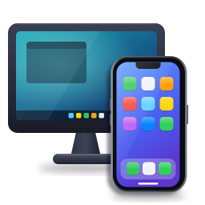
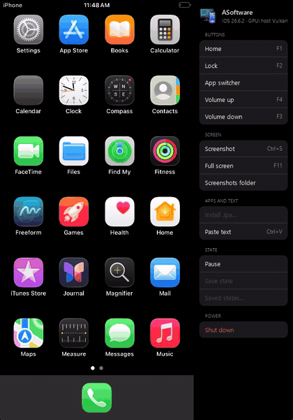

<div align="center">



# ASoftware iOS

**Apple's iOS in a window on your Windows PC.**<br>
iOS 16, ready to install · **new:** iOS 26, drawn by your PC's GPU


-1c1c1e?style=flat-square)


[](https://github.com/alpersamur3/asoft-ios/releases/latest)

<br>



<sub>iOS 26.6.2 in the ASoftware window on Windows 11, in real time with the pauses between gestures cut: iOS's own Metal draws the interface, on an NVIDIA RTX 4080 through Vulkan.</sub>

English · [Türkçe](#turkce)

</div>

## Two iOS versions

| | iOS 16 | iOS 26 (new) |
| --- | --- | --- |
| **State** | Ready: a one-line installer | Research preview: the same installer builds it on your PC (two to three hours, about 50 GB at the peak) |
| **Graphics** | The CPU | **The PC's GPU**: iOS's own Metal, through Vulkan |
| **iOS** | 16.7.16 of the iPhone X | 26.6.2 of the iPhone 16, on the kernel of Apple's research VM |
| **Apps** | Safari with real web pages, `.ipa` installs | Safari with real web pages, `.ipa` installs (at the next start), the system apps, Settings, [OpenGL ES](ios26/README.md#what-works) (our test app so far) |
| **Quick boot** | Yes: iOS goes on in seconds | Yes: iOS goes on in seconds |
| **Start** | [Install](#install) | [Install](#install), then [`ios26/`](ios26/README.md) |

Is it really the GPU? See [the measurements](ios26/README.md#is-it-really-the-gpu).

**watchOS 27.2** (research preview): an Apple Watch Series 9 in a drawn case, on the same GPU path. It
does not need iOS 26, only the base it shares with it (cloudOS's kernel and firmware, the GPU driver:
about 1 GB from Apple), which an iOS 26 install has already. See [`watchos/`](watchos/README.md).

**visionOS 27.2** (research preview): the Apple Vision Pro's Home, Settings and Safari in a window drawn
as the headset, its 3D compositor on the same GPU path. The mouse is your eyes and your pinch; with the
right button held you look around and walk (W A S D). Like the watch it needs only the base it shares
with iOS 26, and WSL. It is slow (about 5 minutes to Home on a cold start, about 15 seconds from a quick
save) and silent for now: sound needs a plug-in that is not published yet. Its installer is new and has
not been run end to end yet. See [`visionos/`](visionos/README.md).

**`ASoftware.exe`** is the launcher: it installs, starts and closes each system, holds its settings and
saves, sends iOS to an Android phone ([ASoftware iOS for Android](https://github.com/alpersamur3/asoft-ios-android))
and packs a problem report. The `.cmd` scripts below still work without it. One QEMU build runs all four
systems ([QEMU](#qemu)).

The rest of this page is about iOS 16; iOS 26 has [its own page](ios26/README.md).

ASoftware iOS boots the real, unmodified iOS 16.7.16 of the iPhone X on QEMU, on an ordinary
Windows PC: SpringBoard, Settings, Safari and the apps you install. The kernel is Apple's
open-source XNU with the patches of [ios-sweet](https://github.com/dipa-studio/ios-sweet), which
first brought this userland up on a Redmi Note 10 Pro, plus our own for QEMU's virtual hardware.

> [!NOTE]
> Experimental. Everything is emulated on the CPU (no GPU), so it is slower than a phone, and
> Apple's security model is mostly switched off. Not affiliated with Apple. No Apple software
> is in this repository: the installer downloads the iOS image from Apple and builds the disk
> on your PC.

## Features

| | |
| --- | --- |
| **iOS** | Lock and home screen, wallpapers and widgets, Control Center, Settings, Safari with real web pages |
| **Apps** | Install `.ipa` files from Windows while iOS runs: the side bar's *Install .ipa…* or a folder |
| **Input** | Mouse as the touchscreen, the wheel to scroll, the PC keyboard as a hardware keyboard, text pasted from the PC |
| **Window** | Phone-shaped, with a side bar in iOS's own dark style: Home, Lock, App switcher, volume, screenshots |
| **Quick boot** | Closing the window saves iOS as it is; the next start goes on from there in seconds. The save stays as a way back: after a *Shut down*, `ASoftware.exe`'s *Go back* returns to it until the next save replaces it |
| **States** | Pause and resume, save the whole machine and go back to it later; the clock catches up after either |
| **Clock** | Your PC's time zone, region format and 12/24-hour clock |
| **Disk** | What iOS writes is kept between starts; *Shut down* turns iOS off cleanly |
| **Network** | Internet through QEMU's user network |

Not yet: audio, GPU acceleration, the App Store and Apple ID services.

## Requirements

- Windows 10 (1903 or later) or 11, 64-bit; no admin rights, WSL or Mac needed
- A 4-core CPU or better and 16 GB of RAM (iOS gets 7 GB)
- About **27 GB** free while installing and **14 GB** once installed (see [Disk space](#disk-space))
- iOS 26 also wants a GPU with a Vulkan driver, 8 or more logical processors and about 57 GB free
  while installing; the installer checks these first. It gets 4 GB of RAM unless you choose 3, 6 or
  8 GB in `ASoftware.exe`, which checks for that much plus about 3.5 GB of free memory before it starts

## Install

One installer for all of them: `Install-ASoftware.cmd`. Run it from a checkout of `main`, or
from `ASoftware-iOS-*-win64.zip` ([Releases](https://github.com/alpersamur3/asoft-ios/releases)), or
in PowerShell:

```powershell
powershell -ExecutionPolicy Bypass -c "irm https://github.com/alpersamur3/asoft-ios/releases/latest/download/Get-ASoftware.ps1 | iex"
```

It asks two things:

1. **Which system:** iOS 16, iOS 26, both (one QEMU for both, downloaded once), or watchOS 27.2 or
   visionOS 27.2 alone (only the base they share with iOS 26, not iOS 26 itself; they need WSL). With
   iOS 26 it also asks whether to add watchOS and visionOS.
2. **For iOS 26, where its build runs Linux tools:** *Fast install (WSL)*, or *Install without
   WSL* (a small Linux VM in our QEMU; no administrator, no restart).
   - WSL is the default when it works.
   - If WSL is missing, it offers to install it, which needs an administrator and a restart; run
     the installer again afterwards and it goes on. Or it goes on without WSL.
   - With virtualization off in the BIOS/UEFI, WSL 2 cannot start, so it installs without WSL and
     says why.
   - iOS 16 never needs WSL.

Before anything starts it shows what each path takes on your PC:
- the download, exact, from the installers' own file lists;
- the disk space at the peak and after;
- the time, from our measured steps scaled to your PC's cores and to a 10 MB probe of Apple's servers.

On our PC (i7-13700HX, 24 threads, NVMe SSD, 40 Mbit/s):

| | Download | Disk: peak / after | Time |
| --- | --- | --- | --- |
| iOS 16 | 6.3 GB | 27 GB / 13.6 GB | about 1 h 5 min (measured: 43 min plus the download) |
| iOS 26, fast install (WSL) | 11.4 GB | 49 GB / 25 GB | about 1 h 45 min (measured: 75 min of steps, plus the 11 GB from Apple, about 30 min at 52 Mbit/s) |
| iOS 26, without WSL | 11.4 GB | 49 GB / 25 GB | about 2 h 35 min (measured end to end: 107 min of steps, plus the 11 GB from Apple, 47 min at about 32 Mbit/s) |
| Both (WSL) | 17.6 GB | 62 GB / 38 GB | about 2 h 50 min |
| watchOS alone (WSL) | 6.2 GB | 23 GB / 16 GB | about 1 h (measured end to end: 56 min, of which 32 min for the 6.2 GB from Apple at about 30 Mbit/s and 16 min for the watch's first start) |
| visionOS alone (WSL) | 18.8 GB | 22 GB / 22 GB | about 2 h 30 min (an estimate from the steps of our hand-run build: the installer has not been run end to end yet) |

A new WSL distro for iOS 26 adds 0.9 GB to the download, about 15 minutes (the hfsplus module is
built for your WSL kernel) and about 7 GB on the drive WSL keeps its distros on.

While it runs, the window title shows the step, the time so far and the time left. At the end it
prints what it took and where everything is (also `install-summary.txt`). Everything goes into one
folder: `-Dir`, or `X:\ASoftware` on the drive with the most room (no spaces, for iOS 26).
Stopped, or restarted for WSL? Run it again: it goes on where it stopped.

| Option | Does |
| --- | --- |
| `-Version ios16\|ios26\|both\|watchos\|ios16-watchos\|visionos\|ios16-visionos`, `-Watch yes\|no`, `-Vision yes\|no`, `-Linux wsl\|helper` | Answers the questions (`watchos`, `visionos`: without iOS 26) |
| `-VisionQemu <folder>` | visionOS from a checkout: a build of our QEMU with its options (release packages from 0.3.0 on have one in `qemu\bin`, which the installer finds itself) |
| `-Dir D:\ASoftware` | The install folder |
| `-Yes` | Asks nothing |
| `-Estimate` | Shows what it takes and stops |
| `-DryRun`, `-List`, `-Check` | What it would run, the steps, what is done; changes nothing |

iOS 16's part is `installer\Install-ASoftware.ps1`, which also runs alone (iOS 26's is
[`ios26\Install-iOS26.ps1`](ios26/README.md)):

1. the app, our QEMU build and Python
2. iOS 16.7.16 for the iPhone X, 6.2 GB from Apple (or `-Ipsw` with one you have), and the
   phone's device tree from it
3. the iOS disk, built from it by a small Linux VM in QEMU (21 min)
4. iOS's first start, which sets up its app database once (22 min)
5. a desktop shortcut

A 4-core CPU takes longer. After that iOS starts in seconds with quick boot.

## Use

| In the window | Does |
| --- | --- |
| Mouse | Touch: click to tap, drag to swipe |
| **F1** / *Home* | Home (unlock, leave an app) |
| **F2** / *Lock* | Side button: lock, or wake when the screen is off |
| **F3** / **F4** | Volume down / up |
| Wheel | Scrolls: a swipe where the pointer is |
| *App switcher* | The app switcher (as the swipe up and hold) |
| Other keys | A hardware keyboard |
| **Ctrl+V** / *Paste text* | Types the PC's clipboard text (letters, digits and symbols of a US keyboard) |
| **Ctrl+S** / *Screenshot* | A PNG in `Pictures\iOS Screenshots` |
| **F11** / *Full screen* | Full screen and back |
| *Install .ipa…* | Installs apps; or drop `.ipa` files into the `ipa` folder |
| *Pause* / *Resume* | Stops iOS where it is, or goes on |
| *Save state* / *Saved states…* | Saves the whole machine (about 3 GB, a few seconds), or goes back to one or deletes it |
| Close the window | Saves iOS as it is and quits; the next start resumes it |
| *Shut down* | Turns iOS off cleanly (about 10 s); pressed again, quits at once |

## Disk space

| | While installing | Installed |
| --- | --- | --- |
| iOS image from Apple (IPSW) | 6.2 GB | removed (kept with `-KeepIpsw`) |
| iOS disk | 12.4 GB | 12.9 GB after the first start |
| Room to build it | 7.6 GB | removed |
| App, QEMU, Python, kernel | 0.7 GB | 0.7 GB |
| A saved state (quick boot, *Save state*) | | about 3 GB each |
| **Total** | **about 27 GB** | **about 13.6 GB**, plus what iOS stores as you use it |

## How it works

```
Windows ── QEMU (-M virt, TCG; our window: side bar, phone shape, power key, quick boot)
             └─ XNU kernel (ios-sweet + ASoftware patches: virtio disk/net/input, ramfb, AMFI, ...)
                  └─ iOS 16.7.16 userland of the iPhone X, unmodified, on one HFS+ disk
                       └─ asoftinstalld (ours): .ipa installs, time zone, region, clock
```

| Path | What |
| --- | --- |
| `xnu/patches/` | Patches on Apple's XNU: 0001-0081 from ios-sweet, 0082 on for QEMU |
| `installer/` | The installer, and the helper VM (arm64 Linux) that builds the iOS disk |
| `tools/` | Device tree, boot payload, QEMU launcher, iOS root builder, disk tool |
| `apps/` | Our iOS programs: `asoftinstalld` and a test app |
| `scripts/` | Windows launcher, .ipa server, WSL disk build; `dev/` for benchmarks and debugging |
| `assets/` | The logo |

Builds: the kernel and the iOS apps on macOS (`.github/workflows/xnu.yml`, `ios-apps.yml`),
QEMU on Windows ([below](#qemu)), the helper VM on Linux (`installer/helper/build-*.sh`).

### QEMU

One QEMU build runs all four systems: [alpersamur3/qemu-sptm](https://github.com/alpersamur3/qemu-sptm/tree/asoft-release),
branch `asoft-release` (`asoft` before 0.3.0, `ios26` until 2026-11-01; QEMU 11.1 with jprx's
research-VM work and our iOS 26 machine), built by [`ios26/scripts/win-build.sh`](ios26/scripts/win-build.sh). `-M virt` boots
iOS 16 as before, `-M vresearch` boots iOS 26, watchOS and visionOS. The release zip carries the
build in `qemu\bin` (its `SOURCES.md` names the branches), and every installer takes it from there.
From a checkout, the iOS 16 and iOS 26 installers download its release package
([`asoft-7364c4e`](https://github.com/alpersamur3/qemu-sptm/releases/tag/asoft-7364c4e)), which does
not have the watch's and the headset's options yet (the watch's screen and crown; the headset's
window, its walk mode and `-cpu x-tlbi-filter`): there, give watchOS and visionOS a build with
`-WatchQemu` / `-VisionQemu`. The launchers run it from `work\qemu`; the watch's installer keeps
its copy in `work\qemu-watch`, and visionOS's puts it in place of `work\qemu`.

Our window for iOS 16 was eight patches on QEMU 11.1.2 in `qemu/patches/`. They are commits on
that branch now, unchanged:

| Patch | Commit | What |
| --- | --- | --- |
| 0002 | [`141c6c6`](https://github.com/alpersamur3/qemu-sptm/commit/141c6c6) | The window refreshes at most every 30 ms |
| 0003 | [`0b8513d`](https://github.com/alpersamur3/qemu-sptm/commit/0b8513d) | `window-close=off`: closing the window powers iOS down |
| 0004 | [`bceefed`](https://github.com/alpersamur3/qemu-sptm/commit/bceefed) | The window title is `-name` alone |
| 0005 | [`41c7c5b`](https://github.com/alpersamur3/qemu-sptm/commit/41c7c5b) | `zoom-to-fit` opens the window at the phone's shape |
| 0006 | [`e35ca2b`](https://github.com/alpersamur3/qemu-sptm/commit/e35ca2b) | The side bar with the phone's buttons |
| 0007 | [`96015e5`](https://github.com/alpersamur3/qemu-sptm/commit/96015e5) | The *Screen off* cover, from the kernel's Scroll Lock LED |
| 0008 | [`ec0de47`](https://github.com/alpersamur3/qemu-sptm/commit/ec0de47) | ASoftware's look: logo, icon, dark side bar |
| 0009 | [`b817605`](https://github.com/alpersamur3/qemu-sptm/commit/b817605) | Quick boot, saved states, pause, app switcher, wheel swipes, pasted text |

`qemu/patches/`, `qemu/build-windows.sh` and the `qemu-win` workflow (stock and patched QEMU
11.1.2, side by side) were removed: nothing ships that build any more, and keeping a second copy
of the same patches in step with the branch would be work for a QEMU nobody runs. Their last
version is in the history (`git show 4dd2fce:qemu/patches`), with the stock build the 30 ms
refresh was measured against (2026-10-21).

## Credits and licenses

- [ios-sweet](https://github.com/dipa-studio/ios-sweet) by dipa-studio and contributors (MIT): the
  XNU port this project is built on.
- This repository: MIT, see [LICENSE](LICENSE) (dipa-studio and ASoftware).
- `xnu/patches/` modify Apple's XNU (Apple Public Source License 2.0); a kernel built from them is
  under the APSL too. Our QEMU, [alpersamur3/qemu-sptm](https://github.com/alpersamur3/qemu-sptm)
  (a fork of [jprx/qemu-sptm](https://github.com/jprx/qemu-sptm)), is QEMU's GPL v2.
- iOS is Apple's and is not distributed here. Apple, iPhone and iOS are trademarks of Apple Inc.

---

<a name="turkce"></a>

<details>
<summary><b>Türkçe</b></summary>

<br>

**İki iOS sürümü**

| | iOS 16 | iOS 26 (yeni) |
| --- | --- | --- |
| **Durum** | Hazır: tek satırlık kurulum | Araştırma önizlemesi: aynı kurucu bilgisayarınızda derler (iki üç saat, en çok yaklaşık 50 GB) |
| **Grafik** | İşlemci | **Bilgisayarın ekran kartı**: iOS'un kendi Metal'i, Vulkan üzerinden |
| **iOS** | iPhone X'in 16.7.16'sı | iPhone 16'nın 26.6.2'si, Apple'ın araştırma VM'inin çekirdeğinde |
| **Uygulamalar** | Gerçek web sayfalarıyla Safari, `.ipa` kurma | Gerçek web sayfalarıyla Safari, `.ipa` kurma (sonraki açılışta), sistem uygulamaları, Ayarlar, [OpenGL ES](ios26/README.md#turkce) (şimdilik test uygulamamız) |
| **Hızlı açılış** | Var: iOS saniyeler içinde kaldığı yerden devam eder | Var: iOS saniyeler içinde kaldığı yerden devam eder |
| **Başlangıç** | [Kurulum](#kurulum) | [Kurulum](#kurulum), sonra [`ios26/`](ios26/README.md#turkce) |

Gerçekten ekran kartı mı? [Ölçümler](ios26/README.md#is-it-really-the-gpu).

**watchOS 27.2** (araştırma önizlemesi): çizilmiş bir kasa içinde Apple Watch Series 9, aynı GPU yolunda.
iOS 26 gerekmez, yalnız onunla paylaştığı taban (cloudOS'un çekirdeği ve ürün yazılımı, GPU sürücüsü:
Apple'dan yaklaşık 1 GB); iOS 26 kuruluysa bu taban zaten vardır. Bkz. [`watchos/`](watchos/README.md).

**visionOS 27.2** (araştırma önizlemesi): başlık olarak çizilmiş bir pencerede Apple Vision Pro'nun Home'u,
Ayarlar'ı ve Safari'si; 3B birleştiricisi aynı GPU yolunda. Fare gözünüz ve parmak sıkıştırmanızdır; sağ
tuş basılıyken etrafa bakar ve yürürsünüz (W A S D). Saat gibi yalnız iOS 26 ile paylaştığı tabanı ve
WSL'i ister. Yavaştır (soğuk açılışta Home'a yaklaşık 5 dakika, hızlı kayıttan yaklaşık 15 saniye) ve
şimdilik sessizdir: ses, henüz yayımlanmamış bir eklenti ister. Kurucusu yenidir ve henüz uçtan uca
çalıştırılmadı. Bkz. [`visionos/`](visionos/README.md).

**`ASoftware.exe`** başlatıcıdır: her sistemi kurar, açar ve kapatır, ayarlarını ve kayıtlarını tutar,
iOS'u Android telefona gönderir ([ASoftware iOS for Android](https://github.com/alpersamur3/asoft-ios-android))
ve sorun raporu hazırlar. Aşağıdaki `.cmd` betikleri onsuz da çalışır. Dört sistemi de tek bir QEMU
derlemesi çalıştırır ([QEMU](#qemu-1)).

Aşağısı iOS 16 hakkında.

ASoftware iOS, iPhone X'in gerçek ve değiştirilmemiş iOS 16.7.16'sını sıradan bir Windows
PC'de, QEMU'da açar: SpringBoard, Ayarlar, Safari ve kurduğunuz uygulamalar. Çekirdek, Apple'ın
açık kaynak XNU'su; üzerinde bu sistemi ilk kez bir Redmi Note 10 Pro'da açan
[ios-sweet](https://github.com/dipa-studio/ios-sweet) yamaları ve QEMU'nun sanal donanımı için
bizim yamalarımız var.

> [!NOTE]
> Deneysel. Her şey işlemcide öykünülüyor (GPU yok), bu yüzden telefondan yavaş; Apple'ın
> güvenlik modeli büyük ölçüde kapalı. Apple ile bir bağı yoktur. Bu repoda Apple yazılımı
> yoktur: kurulum programı iOS kalıbını Apple'dan indirir ve diski sizin bilgisayarınızda kurar.

### Özellikler

| | |
| --- | --- |
| **iOS** | Kilit ve ana ekran, duvar kağıtları ve widget'lar, Denetim Merkezi, Ayarlar, gerçek sayfaları açan Safari |
| **Uygulamalar** | iOS açıkken Windows'tan `.ipa` kurma: kenar çubuğundaki *Install .ipa…* ya da bir klasör |
| **Giriş** | Fare dokunmatik ekran, tekerlek kaydırma, PC klavyesi donanım klavyesi, PC'den metin yapıştırma |
| **Pencere** | Telefon biçiminde, iOS'un kendi koyu tarzında kenar çubuğu: Home, kilit, uygulama değiştirici, ses, ekran görüntüsü |
| **Hızlı açılış** | Pencereyi kapatmak iOS'u olduğu gibi kaydeder; sonraki açılış saniyeler içinde oradan devam eder. Kayıt geri dönüş olarak kalır: *Shut down* sonrası `ASoftware.exe`'deki *Go back*, sonraki kayıt yerini alana kadar ona döner |
| **Durumlar** | Duraklatma ve devam, tüm makineyi kaydedip sonra ona dönme; ikisinden sonra da saat kendini düzeltir |
| **Saat** | PC'nizin saat dilimi, bölge biçimi ve 12/24 saat ayarı |
| **Disk** | iOS'un yazdıkları açılışlar arasında saklanır; *Shut down* iOS'u düzgünce kapatır |
| **Ağ** | QEMU'nun kullanıcı ağıyla internet |

Henüz yok: ses, GPU hızlandırma, App Store ve Apple Kimliği hizmetleri.

### Gereksinimler

- Windows 10 (1903 ve sonrası) ya da 11, 64 bit; yönetici izni, WSL ya da Mac gerekmez
- 4 çekirdekli ya da daha iyi bir işlemci ve 16 GB RAM (iOS 7 GB kullanır)
- Kurulum sırasında yaklaşık **27 GB**, kurulumdan sonra **14 GB** boş alan ([Disk alanı](#disk-alanı))
- iOS 26 ayrıca Vulkan sürücülü bir ekran kartı, 8 ya da daha fazla mantıksal işlemci ve kurulum
  sırasında yaklaşık 57 GB boş alan ister; kurucu bunlara önce bakar. `ASoftware.exe`'de 3, 6 ya da
  8 GB seçilmezse 4 GB RAM kullanır; açmadan önce bu kadarına ek yaklaşık 3,5 GB boş bellek arar

### Kurulum

Hepsi için tek kurucu: `Install-ASoftware.cmd`. `main`'in bir kopyasından, ya da
[Releases](https://github.com/alpersamur3/asoft-ios/releases) sayfasındaki `ASoftware-iOS-*-win64.zip`'ten
çalıştırın; ya da PowerShell'de:

```powershell
powershell -ExecutionPolicy Bypass -c "irm https://github.com/alpersamur3/asoft-ios/releases/latest/download/Get-ASoftware.ps1 | iex"
```

İki şey sorar:

1. **Hangi sistem:** iOS 16, iOS 26, ikisi (ikisine tek QEMU, bir kez indirilir), yalnız watchOS 27.2
   ya da yalnız visionOS 27.2 (iOS 26'nın kendisi değil, yalnız onunla paylaştıkları taban; WSL
   isterler). iOS 26 seçilince watchOS'un ve visionOS'un da eklenip eklenmeyeceğini sorar.
2. **iOS 26 için, derleme Linux araçlarını nerede çalıştırsın:** *Hızlı kurulum (WSL)* ya da
   *WSL'siz kurulum* (QEMU'muzda küçük bir Linux VM; yönetici izni ve yeniden başlatma gerekmez).
   - WSL çalışıyorsa varsayılan WSL'dir.
   - WSL yoksa kurmayı önerir; bu yönetici izni ve yeniden başlatma ister, sonra kurucuyu yeniden
     çalıştırınca kaldığı yerden sürer. Ya da WSL'siz devam eder.
   - Sanallaştırma BIOS/UEFI'de kapalıysa WSL 2 çalışamaz; kurucu nedenini söyleyip WSL'siz kurar.
   - iOS 16 hiç WSL istemez.

Bir şey başlamadan önce her yolun bilgisayarınızda ne gerektirdiğini gösterir:
- indirme, kesin, kurucuların kendi dosya listelerinden;
- en çok ve sonra kalan disk alanı;
- süre, bizim ölçtüğümüz adımlardan, bilgisayarınızın çekirdek sayısına ve Apple'ın sunucularından
  10 MB'lık bir ölçüme göre.

Bizim bilgisayarda (i7-13700HX, 24 iş parçacığı, NVMe SSD, 40 Mbit/s):

| | İndirme | Disk: en çok / sonra | Süre |
| --- | --- | --- | --- |
| iOS 16 | 6,3 GB | 27 GB / 13,6 GB | yaklaşık 1 sa 5 dk (ölçülen: 43 dk artı indirme) |
| iOS 26, hızlı kurulum (WSL) | 11,4 GB | 49 GB / 25 GB | yaklaşık 1 sa 45 dk (ölçülen: 75 dk adım süresi, artı Apple'dan 11 GB, 52 Mbit/s'de ~30 dk) |
| iOS 26, WSL'siz | 11,4 GB | 49 GB / 25 GB | yaklaşık 2 sa 35 dk (uçtan uca ölçülen: 107 dk adım süresi, artı Apple'dan 11 GB, ~32 Mbit/s'de 47 dk) |
| İkisi (WSL) | 17,6 GB | 62 GB / 38 GB | yaklaşık 2 sa 50 dk |
| Yalnız watchOS (WSL) | 6,2 GB | 23 GB / 16 GB | yaklaşık 1 sa (uçtan uca ölçüldü: 56 dk; 32 dakikası Apple'dan 6,2 GB, yaklaşık 30 Mbit/s ile, 16 dakikası saatin ilk açılışı) |
| Yalnız visionOS (WSL) | 18,8 GB | 22 GB / 22 GB | yaklaşık 2 sa 30 dk (elle yaptığımız kurulumun adımlarından tahmin: kurucu henüz uçtan uca çalıştırılmadı) |

iOS 26 için yeni bir WSL dağıtımı indirmeye 0,9 GB, süreye yaklaşık 15 dakika (hfsplus modülü WSL
çekirdeğinize göre derlenir) ve WSL'in dağıtımları tuttuğu sürücüde yaklaşık 7 GB ekler.

Çalışırken pencere başlığı adımı, geçen ve kalan süreyi gösterir. Sonunda ne kadar sürdüğünü ve her
şeyin nerede olduğunu yazar (`install-summary.txt`'ye de). Her şey tek klasöre gider: `-Dir`, ya da en
çok boş yeri olan sürücüde `X:\ASoftware` (iOS 26 için boşluksuz). Durdu mu, ya da WSL için yeniden
başlatıldı mı? Yeniden çalıştırın: kaldığı yerden sürer.

| Seçenek | Ne yapar |
| --- | --- |
| `-Version ios16\|ios26\|both\|watchos\|ios16-watchos\|visionos\|ios16-visionos`, `-Watch yes\|no`, `-Vision yes\|no`, `-Linux wsl\|helper` | Soruları yanıtlar (`watchos`, `visionos`: iOS 26'sız) |
| `-VisionQemu <klasör>` | Depo kopyasından visionOS: seçeneklerini içeren QEMU derlememiz (0.3.0'dan itibaren sürüm paketlerinde `qemu\bin` içinde vardır, kurucu kendisi bulur) |
| `-Dir D:\ASoftware` | Kurulum klasörü |
| `-Yes` | Hiçbir şey sormaz |
| `-Estimate` | Ne gerektirdiğini gösterip durur |
| `-DryRun`, `-List`, `-Check` | Ne çalıştıracağı, adımlar, ne yapıldığı; hiçbir şeyi değiştirmez |

iOS 16'nın kısmı `installer\Install-ASoftware.ps1`; tek başına da çalışır (iOS 26'nınki
[`ios26\Install-iOS26.ps1`](ios26/README.md#turkce)):

1. uygulama, QEMU derlememiz ve Python
2. iPhone X için iOS 16.7.16, Apple'dan 6,2 GB (ya da elinizdekiyle `-Ipsw`) ve içinden
   telefonun cihaz ağacı
3. iOS diski, QEMU'daki küçük bir Linux VM'i tarafından kurulur (21 dk)
4. iOS'un ilk açılışı; uygulama veritabanını bir kez kurar (22 dk)
5. masaüstü kısayolu

4 çekirdekli işlemcide daha uzun sürer. Sonrasında iOS hızlı açılışla saniyeler içinde açılır.

### Kullanım

| Pencerede | Ne yapar |
| --- | --- |
| Fare | Dokunma: tıklama dokunur, sürükleme kaydırır |
| **F1** / *Home* | Ana ekran (kilidi açar, uygulamadan çıkar) |
| **F2** / *Lock* | Yan tuş: kilitler, ekran kapalıyken uyandırır |
| **F3** / **F4** | Ses kıs / aç |
| Tekerlek | Kaydırır: imlecin olduğu yerde bir kaydırma hareketi |
| *App switcher* | Uygulama değiştirici (yukarı kaydırıp bekleme gibi) |
| Diğer tuşlar | Donanım klavyesi |
| **Ctrl+V** / *Paste text* | PC panosundaki metni yazar (ABD klavyesinin harf, rakam ve simgeleri) |
| **Ctrl+S** / *Screenshot* | `Resimler\iOS Screenshots` içine PNG |
| **F11** / *Full screen* | Tam ekran ve geri |
| *Install .ipa…* | Uygulama kurar; ya da `.ipa` dosyalarını `ipa` klasörüne bırakın |
| *Pause* / *Resume* | iOS'u olduğu yerde durdurur ya da devam ettirir |
| *Save state* / *Saved states…* | Tüm makineyi kaydeder (yaklaşık 3 GB, birkaç saniye), ya da birine döner veya siler |
| Pencereyi kapatmak | iOS'u olduğu gibi kaydedip çıkar; sonraki açılış oradan devam eder |
| *Shut down* | iOS'u düzgünce kapatır (yaklaşık 10 sn); ikinci kez basınca hemen çıkar |

### Disk alanı

| | Kurulum sırasında | Kurulumdan sonra |
| --- | --- | --- |
| Apple'dan iOS kalıbı (IPSW) | 6,2 GB | silinir (`-KeepIpsw` ile kalır) |
| iOS diski | 12,4 GB | ilk açılıştan sonra 12,9 GB |
| Kurmak için gereken alan | 7,6 GB | silinir |
| Uygulama, QEMU, Python, çekirdek | 0,7 GB | 0,7 GB |
| Kayıtlı durum (hızlı açılış, *Save state*) | | her biri yaklaşık 3 GB |
| **Toplam** | **yaklaşık 27 GB** | **yaklaşık 13,6 GB**, artı kullandıkça iOS'un sakladıkları |

### QEMU

Dört sistemi de tek bir QEMU derlemesi çalıştırır: [alpersamur3/qemu-sptm](https://github.com/alpersamur3/qemu-sptm/tree/asoft-release)
deposunun `asoft-release` dalı (0.3.0'dan önce `asoft`, 2026-11-01'e kadar `ios26`; jprx'in araştırma
VM'i çalışması ve bizim iOS 26 makinemizle QEMU 11.1), [`ios26/scripts/win-build.sh`](ios26/scripts/win-build.sh) ile derlenir.
`-M virt` iOS 16'yı eskisi gibi, `-M vresearch` iOS 26'yı, watchOS'u ve visionOS'u açar. Sürüm zip'i
derlemeyi `qemu\bin` içinde taşır (dalları `SOURCES.md` söyler), kurucuların hepsi onu oradan alır.
Depo kopyasından çalışınca iOS 16 ve iOS 26 kurulumları onun sürüm paketini indirir
([`asoft-7364c4e`](https://github.com/alpersamur3/qemu-sptm/releases/tag/asoft-7364c4e)); o pakette
saatin ve başlığın seçenekleri henüz yoktur (saatin ekranı ve tacı; başlığın penceresi, yürüme modu ve
`-cpu x-tlbi-filter`): orada watchOS ve visionOS'a `-WatchQemu` / `-VisionQemu` ile bir derleme verin.
Başlatıcılar onu `work\qemu` içinden çalıştırır; saatin kurucusu kendi kopyasını `work\qemu-watch`
içinde tutar, visionOS'unki onu `work\qemu`'nun yerine koyar. iOS 16 penceresinin QEMU 11.1.2 üzerindeki sekiz yaması (`qemu/patches/`, 0002-0009)
artık bu dalda değiştirilmeden birer commit'tir (liste yukarıda, İngilizce bölümün *QEMU* başlığında).
`qemu/patches/`, `qemu/build-windows.sh` ve `qemu-win` iş akışı kaldırıldı: o derlemeyi artık hiçbir şey
dağıtmıyor, aynı yamaların ikinci bir kopyasını dalla eşit tutmak kimsenin çalıştırmadığı bir QEMU için
emek olurdu. Son hâlleri geçmişte duruyor (`git show 4dd2fce:qemu/patches`).

### Emeği geçenler ve lisanslar

- dipa-studio ve katkıda bulunanların [ios-sweet](https://github.com/dipa-studio/ios-sweet) projesi
  (MIT): bu projenin üzerine kurulduğu XNU uyarlaması.
- Bu repo: MIT, bkz. [LICENSE](LICENSE) (dipa-studio ve ASoftware).
- `xnu/patches/` Apple'ın XNU'sunu değiştirir (Apple Public Source License 2.0); bunlardan derlenen
  çekirdek de APSL'dir. QEMU'muz, [alpersamur3/qemu-sptm](https://github.com/alpersamur3/qemu-sptm)
  ([jprx/qemu-sptm](https://github.com/jprx/qemu-sptm) çatalı), QEMU'nun GPL v2 lisansındadır.
- iOS Apple'ındır ve burada dağıtılmaz. Apple, iPhone ve iOS, Apple Inc.'in ticari markalarıdır.

</details>
