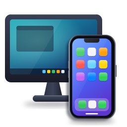

<div align="center">



# ASoftware iOS

**Apple's iOS 16 in a window on your Windows PC.**


-1c1c1e?style=flat-square)


English · [Türkçe](#turkce)

</div>

ASoftware iOS boots the real, unmodified iOS 16.7.16 of the iPhone X on QEMU, on an ordinary
Windows PC: SpringBoard, Settings, Safari and the apps you install. The kernel is Apple's
open-source XNU with the patches of [ios-sweet](https://github.com/dipa-studio/ios-sweet), which
first brought this userland up on a Redmi Note 10 Pro, plus our own for QEMU's virtual hardware.

> [!NOTE]
> Experimental. Everything is emulated on the CPU (no GPU), so it is slower than a phone, and
> Apple's security model is mostly switched off. Not affiliated with Apple. No Apple software
> is in this repository: the installer downloads the iOS image from Apple and builds the disk
> on your PC.

## Features

| | |
| --- | --- |
| **iOS** | Lock and home screen, wallpapers and widgets, Control Center, Settings, Safari with real web pages |
| **Apps** | Install `.ipa` files from Windows while iOS runs: the side bar's *Install .ipa…* or a folder |
| **Input** | Mouse as the touchscreen, the wheel to scroll, the PC keyboard as a hardware keyboard, text pasted from the PC |
| **Window** | Phone-shaped, with a side bar in iOS's own dark style: Home, Lock, App switcher, volume, screenshots |
| **Quick boot** | Closing the window saves iOS as it is; the next start goes on from there in seconds |
| **States** | Pause and resume, save the whole machine and go back to it later; the clock catches up after either |
| **Clock** | Your PC's time zone, region format and 12/24-hour clock |
| **Disk** | What iOS writes is kept between starts; *Shut down* turns iOS off cleanly |
| **Network** | Internet through QEMU's user network |

Not yet: audio, GPU acceleration, the App Store and Apple ID services.

## Requirements

- Windows 10 (1903 or later) or 11, 64-bit; no admin rights, WSL or Mac needed
- A 4-core CPU or better and 16 GB of RAM (iOS gets 7 GB)
- About **26 GB** free while installing and **13 GB** once installed (see [Disk space](#disk-space))

## Install

In PowerShell (no admin rights needed):

```powershell
powershell -ExecutionPolicy Bypass -c "irm https://github.com/alpersamur3/asoft-ios/releases/latest/download/Get-ASoftware.ps1 | iex"
```

Or download `ASoftware-iOS-*-win64.zip` from [Releases](https://github.com/alpersamur3/asoft-ios/releases),
extract it and run `Install-ASoftware.cmd`. It takes about an hour, once (see below), and puts
everything into one folder (`%LOCALAPPDATA%\ASoftware iOS` unless you give `-Dir`); run again,
it resumes where it stopped:

1. the app, our QEMU build and Python
2. iOS 16.7.16 for the iPhone X, 6.2 GB from Apple (or `-Ipsw` with one you have), and the
   phone's device tree from it
3. the iOS disk, built from it by a small Linux VM in QEMU (about 22 min)
4. iOS's first start, which sets up its app database once (20-30 min)
5. a desktop shortcut

Measured on a 16-core laptop CPU (i7-13700HX): the disk 22 min, the first start 21 min, the rest a minute or
two, plus the 6.2 GB download (about 9 min at 100 Mbit/s). A 4-core CPU takes longer. After that
iOS starts in seconds with quick boot.

## Use

| In the window | Does |
| --- | --- |
| Mouse | Touch: click to tap, drag to swipe |
| **F1** / *Home* | Home (unlock, leave an app) |
| **F2** / *Lock* | Side button: lock, or wake when the screen is off |
| **F3** / **F4** | Volume down / up |
| Wheel | Scrolls: a swipe where the pointer is |
| *App switcher* | The app switcher (as the swipe up and hold) |
| Other keys | A hardware keyboard |
| **Ctrl+V** / *Paste text* | Types the PC's clipboard text (letters, digits and symbols of a US keyboard) |
| **Ctrl+S** / *Screenshot* | A PNG in `Pictures\iOS Screenshots` |
| **F11** / *Full screen* | Full screen and back |
| *Install .ipa…* | Installs apps; or drop `.ipa` files into the `ipa` folder |
| *Pause* / *Resume* | Stops iOS where it is, or goes on |
| *Save state* / *Saved states…* | Saves the whole machine (about 3 GB, a few seconds), or goes back to one or deletes it |
| Close the window | Saves iOS as it is and quits; the next start resumes it |
| *Shut down* | Turns iOS off cleanly (about 10 s); pressed again, quits at once |

## Disk space

| | While installing | Installed |
| --- | --- | --- |
| iOS image from Apple (IPSW) | 6.2 GB | removed (kept with `-KeepIpsw`) |
| iOS disk | 11.7 GB | 12.2 GB after the first start |
| Room to build it | 7 GB | removed |
| App, QEMU, Python, kernel | 0.3 GB | 0.3 GB |
| A saved state (quick boot, *Save state*) | | about 3 GB each |
| **Total** | **about 26 GB** | **about 13 GB**, plus what iOS stores as you use it |

## How it works

```
Windows ── QEMU (virt, TCG, our patches: side bar, phone-shaped window, power key, quick boot)
             └─ XNU kernel (ios-sweet + ASoftware patches: virtio disk/net/input, ramfb, AMFI, ...)
                  └─ iOS 16.7.16 userland of the iPhone X, unmodified, on one HFS+ disk
                       └─ asoftinstalld (ours): .ipa installs, time zone, region, clock
```

| Path | What |
| --- | --- |
| `xnu/patches/` | Patches on Apple's XNU: 0001-0081 from ios-sweet, 0082 on for QEMU |
| `qemu/` | Patches on QEMU 11.1.2 and the Windows build script |
| `installer/` | The installer, and the helper VM (arm64 Linux) that builds the iOS disk |
| `tools/` | Device tree, boot payload, QEMU launcher, iOS root builder, disk tool |
| `apps/` | Our iOS programs: `asoftinstalld` and a test app |
| `scripts/` | Windows launcher, .ipa server, WSL disk build; `dev/` for benchmarks and debugging |
| `assets/` | The logo |

Builds: the kernel and the iOS apps on macOS (`.github/workflows/xnu.yml`, `ios-apps.yml`),
QEMU on Windows (`qemu/build-windows.sh` or `qemu-win.yml`), the helper VM on Linux
(`installer/helper/build-*.sh`).

## Credits and licenses

- [ios-sweet](https://github.com/dipa-studio/ios-sweet) by dipa-studio and contributors (MIT): the
  XNU port this project is built on.
- This repository: MIT, see [LICENSE](LICENSE) (dipa-studio and ASoftware).
- `xnu/patches/` modify Apple's XNU (Apple Public Source License 2.0); a kernel built from them is
  under the APSL too. `qemu/patches/` modify QEMU (GPL v2).
- iOS is Apple's and is not distributed here. Apple, iPhone and iOS are trademarks of Apple Inc.

---

<a name="turkce"></a>

<details>
<summary><b>Türkçe</b></summary>

<br>

ASoftware iOS, iPhone X'in gerçek ve değiştirilmemiş iOS 16.7.16'sını sıradan bir Windows
PC'de, QEMU'da açar: SpringBoard, Ayarlar, Safari ve kurduğunuz uygulamalar. Çekirdek, Apple'ın
açık kaynak XNU'su; üzerinde bu sistemi ilk kez bir Redmi Note 10 Pro'da açan
[ios-sweet](https://github.com/dipa-studio/ios-sweet) yamaları ve QEMU'nun sanal donanımı için
bizim yamalarımız var.

> [!NOTE]
> Deneysel. Her şey işlemcide öykünülüyor (GPU yok), bu yüzden telefondan yavaş; Apple'ın
> güvenlik modeli büyük ölçüde kapalı. Apple ile bir bağı yoktur. Bu repoda Apple yazılımı
> yoktur: kurulum programı iOS kalıbını Apple'dan indirir ve diski sizin bilgisayarınızda kurar.

### Özellikler

| | |
| --- | --- |
| **iOS** | Kilit ve ana ekran, duvar kağıtları ve widget'lar, Denetim Merkezi, Ayarlar, gerçek sayfaları açan Safari |
| **Uygulamalar** | iOS açıkken Windows'tan `.ipa` kurma: kenar çubuğundaki *Install .ipa…* ya da bir klasör |
| **Giriş** | Fare dokunmatik ekran, tekerlek kaydırma, PC klavyesi donanım klavyesi, PC'den metin yapıştırma |
| **Pencere** | Telefon biçiminde, iOS'un kendi koyu tarzında kenar çubuğu: Home, kilit, uygulama değiştirici, ses, ekran görüntüsü |
| **Hızlı açılış** | Pencereyi kapatmak iOS'u olduğu gibi kaydeder; sonraki açılış saniyeler içinde oradan devam eder |
| **Durumlar** | Duraklatma ve devam, tüm makineyi kaydedip sonra ona dönme; ikisinden sonra da saat kendini düzeltir |
| **Saat** | PC'nizin saat dilimi, bölge biçimi ve 12/24 saat ayarı |
| **Disk** | iOS'un yazdıkları açılışlar arasında saklanır; *Shut down* iOS'u düzgünce kapatır |
| **Ağ** | QEMU'nun kullanıcı ağıyla internet |

Henüz yok: ses, GPU hızlandırma, App Store ve Apple Kimliği hizmetleri.

### Gereksinimler

- Windows 10 (1903 ve sonrası) ya da 11, 64 bit; yönetici izni, WSL ya da Mac gerekmez
- 4 çekirdekli ya da daha iyi bir işlemci ve 16 GB RAM (iOS 7 GB kullanır)
- Kurulum sırasında yaklaşık **26 GB**, kurulumdan sonra **13 GB** boş alan ([Disk alanı](#disk-alanı))

### Kurulum

PowerShell'de (yönetici izni gerekmez):

```powershell
powershell -ExecutionPolicy Bypass -c "irm https://github.com/alpersamur3/asoft-ios/releases/latest/download/Get-ASoftware.ps1 | iex"
```

Ya da [Releases](https://github.com/alpersamur3/asoft-ios/releases) sayfasından
`ASoftware-iOS-*-win64.zip` dosyasını indirip açın ve `Install-ASoftware.cmd`'yi çalıştırın. Kurulum
bir kez, yaklaşık bir saat sürer (aşağıda). Her şeyi tek klasöre koyar (`-Dir` verilmezse
`%LOCALAPPDATA%\ASoftware iOS`); yeniden çalıştırılınca kaldığı yerden devam eder:

1. uygulama, QEMU derlememiz ve Python
2. iPhone X için iOS 16.7.16, Apple'dan 6,2 GB (ya da elinizdekiyle `-Ipsw`) ve içinden
   telefonun cihaz ağacı
3. iOS diski, QEMU'daki küçük bir Linux VM'i tarafından kurulur (yaklaşık 22 dk)
4. iOS'un ilk açılışı; uygulama veritabanını bir kez kurar (20-30 dk)
5. masaüstü kısayolu

16 çekirdekli bir dizüstü işlemcisinde (i7-13700HX) ölçülen: disk 22 dk, ilk açılış 21 dk, gerisi bir iki dakika,
artı 6,2 GB indirme (100 Mbit/s'de yaklaşık 9 dk). 4 çekirdekli işlemcide daha uzun sürer. Sonrasında
iOS hızlı açılışla saniyeler içinde açılır.

### Kullanım

| Pencerede | Ne yapar |
| --- | --- |
| Fare | Dokunma: tıklama dokunur, sürükleme kaydırır |
| **F1** / *Home* | Ana ekran (kilidi açar, uygulamadan çıkar) |
| **F2** / *Lock* | Yan tuş: kilitler, ekran kapalıyken uyandırır |
| **F3** / **F4** | Ses kıs / aç |
| Tekerlek | Kaydırır: imlecin olduğu yerde bir kaydırma hareketi |
| *App switcher* | Uygulama değiştirici (yukarı kaydırıp bekleme gibi) |
| Diğer tuşlar | Donanım klavyesi |
| **Ctrl+V** / *Paste text* | PC panosundaki metni yazar (ABD klavyesinin harf, rakam ve simgeleri) |
| **Ctrl+S** / *Screenshot* | `Resimler\iOS Screenshots` içine PNG |
| **F11** / *Full screen* | Tam ekran ve geri |
| *Install .ipa…* | Uygulama kurar; ya da `.ipa` dosyalarını `ipa` klasörüne bırakın |
| *Pause* / *Resume* | iOS'u olduğu yerde durdurur ya da devam ettirir |
| *Save state* / *Saved states…* | Tüm makineyi kaydeder (yaklaşık 3 GB, birkaç saniye), ya da birine döner veya siler |
| Pencereyi kapatmak | iOS'u olduğu gibi kaydedip çıkar; sonraki açılış oradan devam eder |
| *Shut down* | iOS'u düzgünce kapatır (yaklaşık 10 sn); ikinci kez basınca hemen çıkar |

### Disk alanı

| | Kurulum sırasında | Kurulumdan sonra |
| --- | --- | --- |
| Apple'dan iOS kalıbı (IPSW) | 6,2 GB | silinir (`-KeepIpsw` ile kalır) |
| iOS diski | 11,7 GB | ilk açılıştan sonra 12,2 GB |
| Kurmak için gereken alan | 7 GB | silinir |
| Uygulama, QEMU, Python, çekirdek | 0,3 GB | 0,3 GB |
| Kayıtlı durum (hızlı açılış, *Save state*) | | her biri yaklaşık 3 GB |
| **Toplam** | **yaklaşık 26 GB** | **yaklaşık 13 GB**, artı kullandıkça iOS'un sakladıkları |

### Emeği geçenler ve lisanslar

- dipa-studio ve katkıda bulunanların [ios-sweet](https://github.com/dipa-studio/ios-sweet) projesi
  (MIT): bu projenin üzerine kurulduğu XNU uyarlaması.
- Bu repo: MIT, bkz. [LICENSE](LICENSE) (dipa-studio ve ASoftware).
- `xnu/patches/` Apple'ın XNU'sunu değiştirir (Apple Public Source License 2.0); bunlardan derlenen
  çekirdek de APSL'dir. `qemu/patches/` QEMU'yu değiştirir (GPL v2).
- iOS Apple'ındır ve burada dağıtılmaz. Apple, iPhone ve iOS, Apple Inc.'in ticari markalarıdır.

</details>
