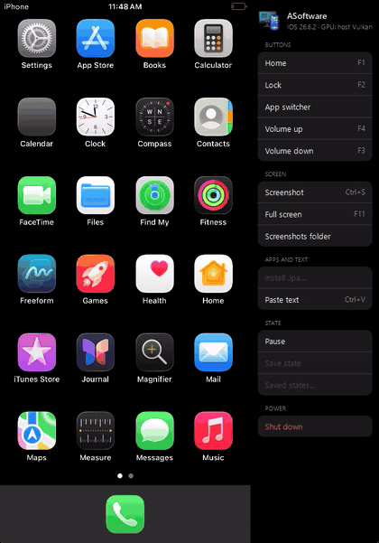
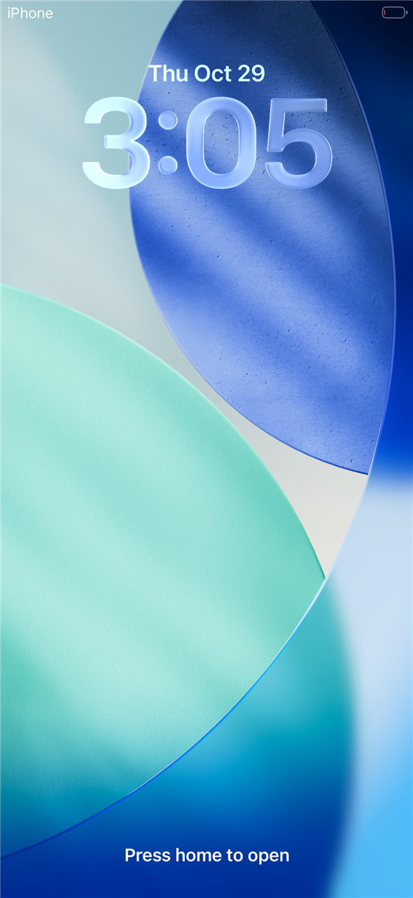
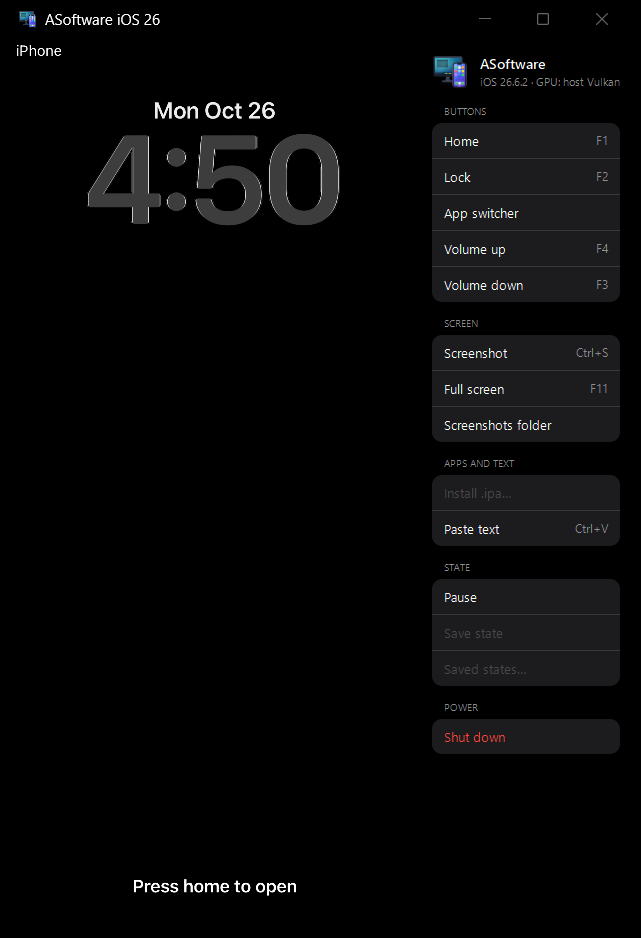
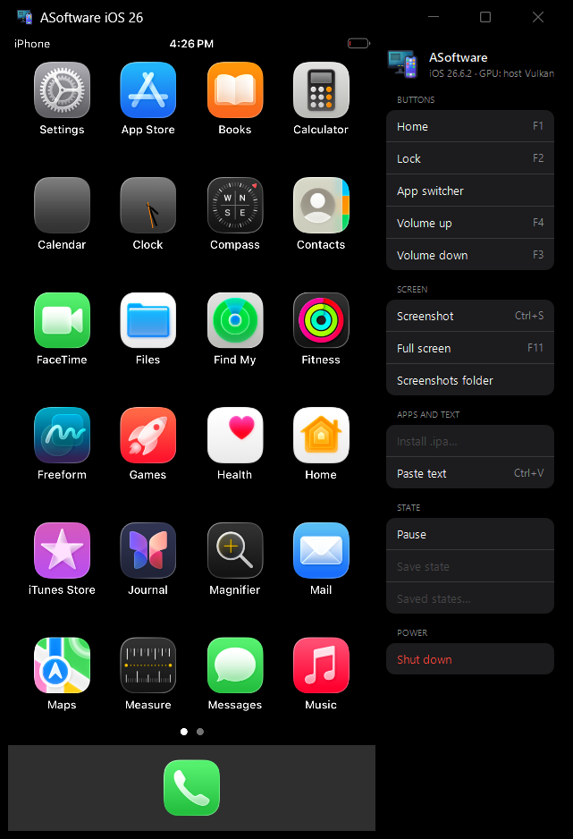
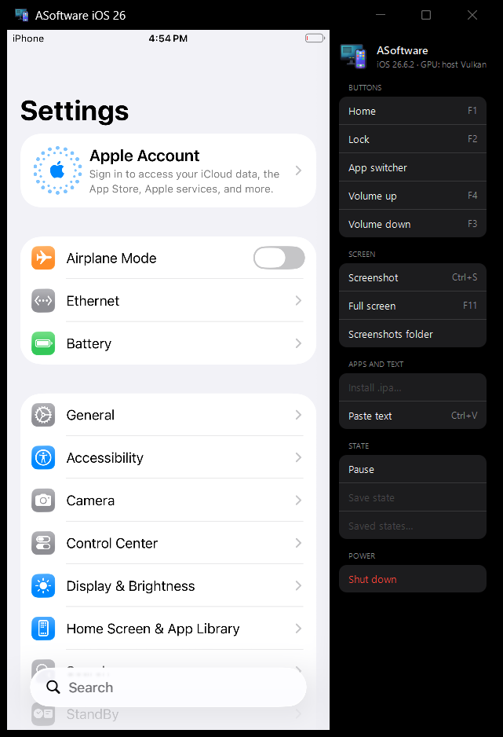
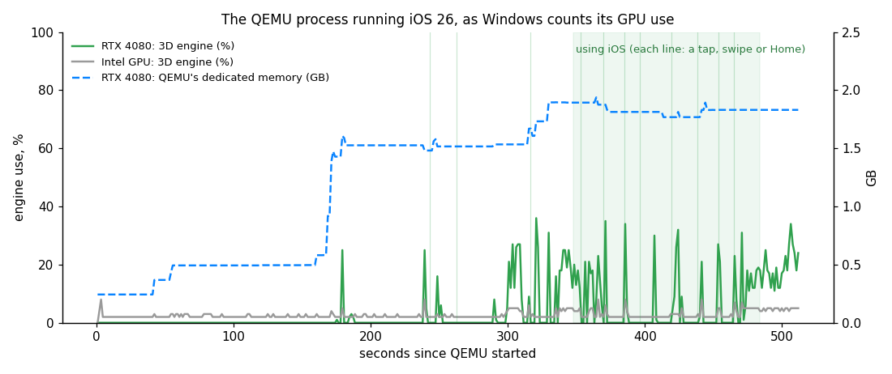
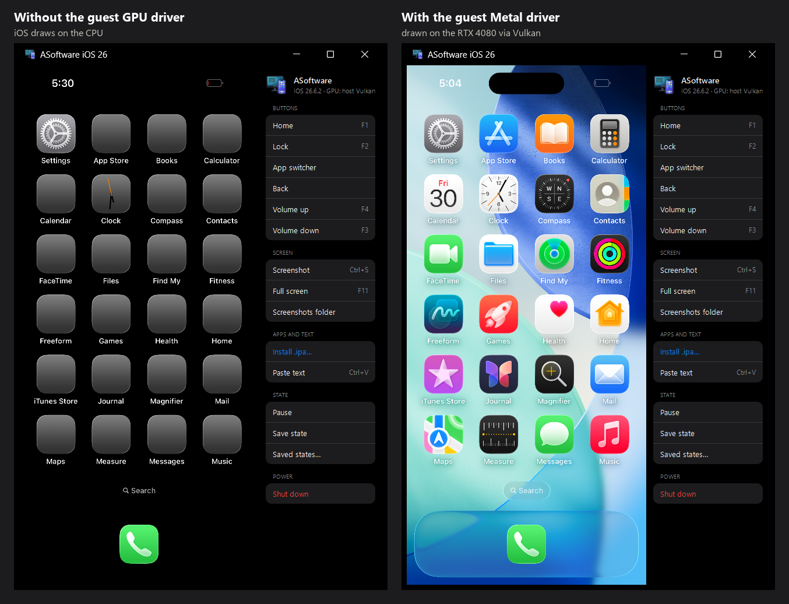

<div align="center">

# ASoftware iOS 26 (research preview)

**iOS 26 in a window on a Windows PC, its interface drawn by the PC's own GPU.**



<sub>Real time, on Windows 11 with an RTX 4080 Laptop: Settings (opened once before), scrolling, General, Home, the home screen's pages.</sub>

English · [Türkçe](#turkce)

</div>

Apple's iOS 26.6.2 userland boots on QEMU on an ordinary x86-64 Windows PC, on the kernel of
Apple's own research VM platform (vphone600, from cloudOS 26.4b). iOS's Metal driver in the guest
sends its work to a paravirtual GPU, and on the PC that work runs on the host GPU through Vulkan:
the lock screen, SpringBoard, Settings and the system apps draw on an NVIDIA RTX 4080 under
Windows. [vphone-linux](https://github.com/YahiaAngelo/vphone-linux) runs the same guest on the
same GPU stack on Linux; this is the Windows host.

> [!WARNING]
> A research preview, not a product: there is no installer, and building the inputs takes the
> steps below, WSL and several hours. Apple's security model is mostly switched off. Not
> affiliated with Apple. No Apple software is in this repository or in our forks: you build
> everything from your own downloads from Apple, and the guest's GPU driver you extract yourself.

## What works

| | |
| --- | --- |
| **GPU** | iOS's own Metal draws the interface; the PC's GPU runs it through Vulkan (tested: NVIDIA RTX 4080 Laptop, Windows 11) |
| **iOS** | Lock screen, home screen with the system apps, Settings and its pages, Weather |
| **Input** | Mouse as the touchscreen (tap, swipe, scroll), the PC keyboard, Home, side button and volume |
| **Gestures** | A Face ID iPhone's (an iPhone 16 Pro's layout: Dynamic Island, its status bar): swipe up to open and to go home, swipe up and hold for the app switcher, Control Center from the top right, Notification Center from the top left, back from the left edge. A drag from the display's left edge becomes iOS's back gesture (a quick swipe is too fast for the emulated app), and the side bar has Back and App switcher |
| **Window** | The ASoftware window and side bar of the iOS 16 build: Home, Lock, App switcher, volume, screenshots, full screen, pasted text |
| **Disk** | As the iOS 16 launcher: a throwaway overlay by default, `-Persist` keeps iOS's changes in a user overlay, `-Keep` writes the base image |
| **Network** | `-Net`: a virtio-net NIC on QEMU's user-mode network; iOS brings `en0` up with 10.0.2.15 (checked with `ifconfig`; nothing beyond that tested) |
| **Wallpaper** | iOS 26's own wallpaper (MercuryPoster: a 3D scene iOS's Metal draws on the PC's GPU) on the lock and home screens, the Liquid Glass clock over it; `-Wallpaper collections` for iOS 17's Collections one (build step 3.6) |
| **Speed** | All CPU work is emulated (QEMU TCG). Measured on an i7-13700HX: lock screen about 100 s after start (160 s before our TCG changes: `notes`), Settings opens in about 4 s, a scroll answers in 0.3 s |

   

Not yet: quick boot and saved states (the GPU device blocks migration for now), `.ipa` installs, a clean
shutdown from the window (closing it quits at once; the default overlay makes that harmless), audio,
the App Store and Apple ID services. For about 3 minutes after the
lock screen appears iOS's daemons keep every vCPU busy, so the first taps are slow.

## Is it really the GPU?

Three checks, each from a different side.

**1. Windows' own counters.** Windows counts GPU use per process: the numbers in Task Manager's
GPU columns. Measured on the QEMU process while iOS 26 ran, on a laptop with two GPUs:

| The QEMU process, from the lock screen on | RTX 4080 Laptop | Intel UHD (the other GPU) |
| --- | --- | --- |
| Dedicated GPU memory | **1.5 to 2.0 GB** | none (0.24 GB shared) |
| 3D engine | **bursts up to 36 %** when iOS draws | flat, 2 to 8 % |



QEMU's memory on the RTX 4080 climbs as iOS boots and loads its interface. The 3D engine works in
bursts, when the lock screen comes up, as Settings opens and scrolls, and at each Home and swipe, then
waits: iOS's CPU work is emulated and keeps four host cores busy, so the CPU, not the GPU, sets the
pace. On the idle home screen iOS keeps drawing, most likely the Clock icon's live hands. Measured on
2026-10-27, in the run the GIF above comes from, on Windows 11, i7-13700HX, RTX 4080 Laptop (driver
610.74), 4 vCPUs, with [`scripts/gpu-sample.ps1`](scripts/gpu-sample.ps1). Two engine samples above
100 %, a glitch of Windows' formatted counters, are left out.

**2. What iOS sends.** reims-vgpu can trace the paravirtual GPU's command stream
(`REIMS_VGPU_TRACE`). We counted it up to the lock screen:
- **Without the guest's Metal driver:** iOS sent 4 command buffers and no GPU textures. It draws
  every surface on the CPU and the host only shows them.
- **With the driver:** iOS sent 573 Metal command buffers and drew into 70 render-target surfaces.

The picture differs too. The dock's platter, a translucent material, appears only when iOS has its
Metal driver:



**3. The library's log.** At start, reims-vgpu names the device it runs the guest's Metal on, and
metal2vulkan names the Vulkan driver it translates for:

```
reims_vgpu_core::device: device starting on Metal device NVIDIA GeForce RTX 4080 Laptop GPU, guest pages of 16 KiB
metal2vulkan: the device NVIDIA GeForce RTX 4080 Laptop GPU: its policy takes native device maths ...
```

To check it yourself, open Task Manager → *Details*, add the *GPU engine* and *Dedicated GPU
memory* columns, and look at `qemu-system-aarch64w.exe` while you use iOS.

## How it works

```
Windows ── QEMU: jprx/qemu-sptm + our -M vresearch machine (TCG)
  │          ├─ SPTM, TXM and the kernel of Apple's research VM platform (cloudOS 26.4b)
  │          │    └─ iOS 26.6.2 userland of the iPhone, on HFS+ disks
  │          │         └─ AppleParavirtGPU Metal driver ──► PVG device (pvg=reims)
  │          ├─ USB: touchscreen (a built-in digitizer), keyboard, consumer keys
  │          └─ software stand-ins for the absent Secure Enclave (keystore, ACM)
  └─ reims-vgpu (ported to Windows) ─► metal2vulkan ─► Vulkan ─► the PC's GPU
```

| Part | Where | What we added |
| --- | --- | --- |
| QEMU | [alpersamur3/qemu-sptm](https://github.com/alpersamur3/qemu-sptm/tree/ios26), branch `ios26` | The `vresearch` machine (boot, device tree, SMP, PVG display and GPU, SEP/keystore/ACM stand-ins, HFS+ data protection), a USB touchscreen and consumer keys, the Windows build, the ASoftware GTK window |
| GPU, host side | [alpersamur3/reims-vgpu](https://github.com/alpersamur3/reims-vgpu/tree/windows), branch `windows` | A Windows OS layer: guest RAM as section views (`MapViewOfFile3` placeholders), IOSurface backing, read-only imports through a writable twin, the x86-64 build serving 16 KiB guest pages |
| Metal → Vulkan | [alpersamur3/metal2vulkan](https://github.com/alpersamur3/metal2vulkan/tree/windows), branch `windows` | The `x86_64-pc-windows-gnu` build |
| This folder | `ios26/` | The launcher and the scripts that build the disk, device tree, trust cache and ramdisk |

## Build

> [!IMPORTANT]
> Written down from the runs that built our disk. Not yet repeated end to end on a second PC, and
> the steps marked *by hand* have no script yet. Read each script before you run it.

### You need

- Windows 10/11 x64, 8 or more cores, 16 GB RAM (the guest gets 4 GB), about 60 GB free
- A Vulkan GPU whose driver has `VK_EXT_external_memory_host` (tested: NVIDIA RTX 4080 Laptop)
- MSYS2 with the UCRT64 toolchain: QEMU's build dependencies (as for [`qemu/build-windows.sh`](../qemu/build-windows.sh)),
  plus GTK 3, ANGLE (`mingw-w64-ucrt-x86_64-angleproject`) and Rust (`mingw-w64-ucrt-x86_64-rust`)
- WSL 2 (Ubuntu), as root: [ipsw](https://github.com/blacktop/ipsw), `qemu-utils`, `hfsprogs`, `gdisk`,
  [apfs-fuse](https://github.com/sgan81/apfs-fuse), `python3`, `rsync`, and an `hfsplus` kernel module
  for WSL's kernel, which has none (`HFSPLUS_KO=path/to/hfsplus.ko`)
- `sysroot/ios_sysroot.tar.gz` from [jprx/darwin-vm](https://github.com/jprx/darwin-vm): bash and
  coreutils for the shell ramdisk and the root

Two folders, set as environment variables:
- `ASOFT26_SRC`: sources and builds, an MSYS path such as `/c/asoft26-src`.
- `ASOFT26`: Apple's files, the disks and the runs. WSL sees it as, say, `/mnt/d/ios26`, and it is
  `-Work D:\ios26` for `Start-iOS26.ps1`.

`ASOFT26_LINUX` (default `/root/ios26`) is scratch space inside WSL.

### 1. QEMU and the GPU library (MSYS2 UCRT64, started from PowerShell)

```
git clone -b ios26 https://github.com/alpersamur3/qemu-sptm %ASOFT26_SRC%\qemu-sptm
git clone -b windows https://github.com/alpersamur3/reims-vgpu %ASOFT26_SRC%\reims-vgpu
git clone -b windows https://github.com/alpersamur3/metal2vulkan %ASOFT26_SRC%\metal2vulkan-win
```

1. `win-nettle.sh`: a static nettle 3.10.1 (put GNU's `nettle-3.10.1.tar.gz` in `deps\dl` first).
2. `ucrt.ps1 ios26\scripts\reims-build.sh`: reims-vgpu → `reims-dist`.
3. `win-build.sh`: QEMU → `dist`. Copy it to `<ASOFT26>\qemu`.

### 2. Apple's files (WSL)

- **cloudOS 26.4b (23E5207q)**, the IPSW of Apple's Private Cloud Compute research VM (vphone600):
  extract it into `$ASOFT26/cloudos`. Used, none of them encrypted:
  - `kernelcache.research.vphone600`
  - `Firmware/sptm.vresearch1.release.im4p`, `Firmware/txm.iphoneos.research.im4p`
  - `all_flash/DeviceTree.vphone600ap.im4p`
  - the ramdisk `094-39914-031.dmg` and its trust cache
- **iPhone17,3 iOS 26.6.2 (23G90)**: `ipsw-get.py URL MEMBER OUT` fetches single members of the IPSW
  into `$ASOFT26/iphone`:
  - `094-97246-090.dmg.aea` (the OS)
  - `094-95368-092.dmg.aea` (the SystemOS cryptex)
  - `094-96441-094.dmg` (AppOS)
  - `Firmware/*.trustcache`
- `sysos.sh` and `m2-decrypt.sh` decrypt the two AEA images into `$ASOFT26/os`. `ipsw fw aea` gets
  the keys from Apple's key service.

### 3. Firmware, device tree and ramdisk (WSL)

1. *By hand*, in `$ASOFT26`: `ipsw img4 im4p extract cloudos/all_flash/DeviceTree.vphone600ap.im4p -o cloud/vphone600ap.adt`
2. `kdec.sh`, then `unwrap-fw.sh` → `fw/bootkc`, `fw/sptm`, `fw/txm`, `fw/dtree.orig`
3. `QEMU_SPTM=<qemu-sptm checkout> python3 dt-root26smp.py fw/dtree.orig dtree-smp4 --cpus 4`
   (`dtree-smp8 --cpus 8` too, if you like: we have not booted 8 yet). With qemu-sptm 5eba0a3 or
   later it fills the product's syscfg keys from the tree's own gestalt variant (it prints the 42
   it filled): without them iOS takes the VM for an iPhone with a Home button (the old status bar,
   "Press home to open", Control Center from the bottom, no home gestures). A disk already booted
   with an older tree keeps that answer in its MobileGestalt cache: `root26-mgcache.py reset` on it.
4. `SYSROOT_TAR=<darwin-vm>/sysroot/ios_sysroot.tar.gz sysroot-check.sh`
5. *By hand:* unwrap the cloudOS ramdisk to `$ASOFT26_LINUX/rd/rd.apfs` and put its trust cache at
   `cloud/rd.trustcache.im4p`. Then run `mk-ramdisk.sh` and copy `rd-shell.hfs` to `$ASOFT26`. The
   machine wants a ramdisk even though iOS's root is on the disk.

### 4. The root disk (WSL, as root)

1. `DROP_SYSOS=1 mk-root26.sh` → `root26.qcow2` and `root26.qcow2.hashes`. If its sysroot step
   stops on `cp -a`'s ACLs, `m2-finish.sh` completes it and applies `root26-tweaks.py`.
2. `mktc.py -2 root.tc iphone/*.trustcache root26.qcow2.hashes`: the trust cache.
3. `mk-root26g.sh root26.qcow2 root26g.qcow2`: the partitioned disk (system and a 16 GB Data volume).
4. Through `root26-do.sh root26g.qcow2 'python3 SCRIPT $R ...'`, in this order:
   1. `root26-prefs.py`, `root26-sb-undiag.py`, `root26-bbd-fix.py`. `root26-prefs.py` also turns
      the side button's press and hold off: under TCG iOS reads a click that wakes the display as
      a press and hold, which opened Siri. On a disk built before 2026-10-29, run it again on the
      top overlay (it is idempotent).
   2. *by hand:* `/private/var/keybags/systembag.kb`, a plist with `KeyBagKeys` = the data `SWEET`
      (owner root, mode 0600)
   3. `root26-churn.py on`, `root26-dbg-off.py`. `root26-churn.py` also takes out DumpPanic, which
      crashes every two minutes for ever, and three daemons that do nothing offline.
   4. On a disk built before 2026-10-30: `root26-commcenter.py` on the top overlay. The old
      `root26-tweaks.py` removed CommCenter, and without it SpringBoard resets its idle timer every
      second: the display never slept, the Lock Screen was drawn for ever (half the guest's CPU in
      the first 30 minutes) and the side button seemed dead. Measured with it back: the Lock Screen
      goes dark in 7 s, the side button locks and wakes, and the work after a start ends in about 15
      minutes instead of 30. See vphone-cli's `Research/Guest/service_trimming.md` before cutting
      more: CommCenter, cloudd, mobileassetd, sleepd and siriactionsd make the guest worse when off.
   5. `root26-trim.py on`: vphone-cli's trimmed service profile for 26.6.2 (120 jobs, as launchd
      overrides in `disabled.plist`; `off` undoes it). `root26-prefs.py` also sets Auto-Lock to
      5 minutes and the Lock Screen to go dark after 60 s instead of 6. On an older disk, run both
      on the top overlay.
5. Boot it once (`Start-iOS26.ps1 -Disk root26g.qcow2`) and quit. Then, again through
   `root26-do.sh`, run `root26-persona.py on` and `root26-mgcache.py reset`. `root26-do.sh` replays
   the HFS+ journal first.

### 5. Activation, the GPU driver and the apps (overlays)

Put each layer in a qcow2 overlay on the one before it, for example
`qemu-img create -f qcow2 -b root26g.qcow2 -F qcow2 root26h.qcow2`. Name the top one `root.qcow2`.
Every binary you change or add needs its CDHash in the trust cache: get it with `cdhash.py FILE`
(or from the output of `reattest.py` / `dsc-patch.py`), then `mktc.py -2 root.tc root.tc hashes.txt`.

1. **Activation:**
   1. Copy `/usr/libexec/mobileactivationd` off the root as `mobileactivationd.orig`.
      `hact_patch.py mobileactivationd.orig mobileactivationd`, then
      `reattest.py mobileactivationd.orig mobileactivationd`.
   2. Put the result at `/usr/libexec/mobileactivationd` (same owner and mode) and add its new CDHash.
   3. We gave its entry the original's constraint category 3. `mktc.py` writes 0 for a text list;
      `amfi-lc-off=on` should make that work too, but we have not tried it.
2. **GPU driver** (optional, see below): put `AppleParavirtGPUMetalIOGPUFamily.bundle` into
   `/System/Library/Extensions` (root:wheel, 755/644) and add the CDHashes of its Mach-Os. Without
   it, iOS draws on the CPU and reims only shows the frames; that also reaches the home screen.
3. **Apps and wallpaper:**
   1. `apply-staged.sh`.
   2. Copy `dyld_shared_cache_arm64e*` from the root's
      `System/Cryptexes/OS/System/Library/Caches/com.apple.dyld` to `$ASOFT26/dsc`.
   3. `dsc-patch.py $ASOFT26/dsc 0x220649088 f6179f1a20070034 3600805239000014 $ASOFT26/dscpatch`
      (PosterBoard's purgeable-file call, which HFS+ refuses).
   4. `apply-apps.sh`, then `root26-nowatchdog.py`.
   5. Add the patched subcache's CDHash.
   6. The wallpaper: iOS 26's default poster, MercuryPoster (`space.dynamic`), is a 3D scene its
      Metal draws; it needs metal2vulkan's `windows` branch at 56705098 or later (before that it
      drew black: its uniforms are bound 4 bytes past a multiple of 16, which iOS allows and the
      translator read 4 bytes early). Boot once with `-Keep` and leave it for 6 minutes:
      PosterBoard's first run writes the poster store, and the throwaway overlay of a normal start
      would redo that every time.
      Optional, a lighter wallpaper (the poster's extension costs the emulated CPU): iOS 17's
      Collections one. PosterBoard picks it for two product types only
      (`_defaultLockScreenWallpaperExtensionIdentifier`, a `B.EQ`); make it unconditional with a
      second 4-byte patch on the same subcache,
      `dsc-patch.py $ASOFT26/dscpatch 0x22066ebc0 a0000054 05000014 $ASOFT26/dscpatch-wp`, write
      that `.42` into an overlay `root-collections.qcow2` on `root.qcow2` as in `apply-apps.sh`
      (`cat >`, keeping the hard link), delete PosterBoard's
      `Library/Application Support/PRBPosterExtensionDataStore` in its data container (its first
      run then sets up wallpaper 7565), copy `root.tc` to `root-collections.tc` with the new
      CDHash added, and bake the store as above with `-Wallpaper collections -Keep`.

4. **Gestures:** `edge-patch.py $ASOFT26/dsc $ASOFT26/dscpatch-edge` (UIKitCore's touch edge type,
   `edge-cave.s`: our touchscreen's driver sets no edge bits, and without them no touch is an edge
   touch: no home gesture, app switcher or edge swipe back). Write that `.03` into the image as
   `apply-apps.sh` writes `.42` and add the CDHash it prints (to `root-collections.tc` too).

Then run `Start-iOS26.ps1 -Work D:\ios26`. The lock screen comes after about 100 s; press Home (F1).

The disk works as in the iOS 16 launcher: by default iOS writes to a throwaway overlay and the
image is as built again at the next start; `-Persist` keeps what iOS writes (settings, apps) in
`root26-user.qcow2`, an overlay on the base image, and `-Persist -Reset` drops that overlay first;
`-Keep` writes the base image itself. Two launchers on one disk refuse to start. `-Net` adds a
virtio-net NIC on QEMU's user-mode network (see *What works*).

### Start menu and setup (Start-iOS26.cmd, Install-iOS26.ps1)

As the iOS 16 launcher does, `Start-iOS26.cmd` offers the start options every time and remembers
your setup. The menu's choices (work folder, wallpaper, disk mode, network, vCPUs) are saved in
`%LOCALAPPDATA%\ASoftware iOS 26\ios26.config.json`, so later starts reuse them; `Start-iOS26.cmd
-NoMenu` starts at once with the saved setup, and `Start-iOS26.ps1 ...` is still the launcher with
every option.

The first run (or `Install-iOS26.ps1`) asks where the work folder is and whether you have the
guest GPU driver, with a folder picker, and saves the path. Without a driver iOS runs *GPU-less*:
it draws on the CPU and the host only shows the frames — it reaches the home screen, but everything
is slower; add the driver later and rebuild the disk (step 5.2) to turn the GPU on. The driver is
baked into the disk when the disk is built, so this records where it is, it is not read at run time.

`Install-iOS26.ps1` runs that setup, then lists which build outputs the work folder already has and
which the *Build* steps above still produce, and makes a Start-menu shortcut. It does not download
Apple's files or build the disk: iOS 26 is a research preview, so that is the *Build* pipeline, by
hand where a step says so.

The published launcher needs a recent build: qemu-sptm `ios26` **4eee4e5** or later (older QEMU
rejects the `usb-kbd` `idle-reports` option and will not boot) and reims-vgpu `windows`
**65e09172** or later (the screen-off cover needs it). Rebuild QEMU (step 1) if yours is older.

`.ipa` installs: the side bar's *Install .ipa…* and the `ipa` folder are wired in the launcher
(`ipa-server.py`, `ASOFT_IPA_DIR`, and `-Net`), and the `asoftinstalld` daemon (built on macOS, as
in the iOS 16 build) runs on the disk, fetches the `.ipa` and reaches installd. But installd wants
an APFS volume and the disk's Data volume is HFS+, so the *live* install stops there (error -4). An
app from an `.ipa` does run on iOS 26 another way: place its `.app` into `/Applications` with its
Mach-O's CDHash in the trust cache and rebuild LaunchServices, exactly as the system apps are
installed (step 5.3 / `apply-apps.sh`). Tested with a small Hello app: it appears on the home screen
and opens. The live `asoftinstalld` path is waiting on an APFS Data volume.

### The guest's GPU driver

`AppleParavirtGPUMetalIOGPUFamily.bundle` is Apple firmware content. It is not in this repository
and never will be: vphone-cli stopped shipping it for the same reason. Extract your own:

- **On an Apple silicon Mac:** [vphone-cli](https://github.com/Lakr233/vphone-cli)'s `fw prepare` copies it
  from the cloudOS image. Its compiler plugin is built with
  [GraphicLoader](https://github.com/Lakr233/vphone-cli/blob/main/VPhoneGuestComponents/GraphicLoader/README.md).
- **Without a Mac:** vphone-linux's
  [CREATE-ON-LINUX.md](https://github.com/YahiaAngelo/vphone-linux/blob/main/docs/CREATE-ON-LINUX.md)
  gets it from a stock cloudOS restore under QEMU on Linux. We have not tried that route.

## Tools

- `Start-iOS26.cmd` / `Start-iOS26-Menu.ps1`: the start menu (above). `Install-iOS26.ps1`: setup
  and the build-output checklist.
- `scripts/ipa-server.py`: serves a Windows folder of `.ipa` files to the guest's `asoftinstalld`
  (the launcher starts it; the guest fetches `http://10.0.2.2:8765`).
- `qmp.py`: taps and swipes over QMP, for scripts and tests.
- `console.py`: the guest's root shell on the serial console (127.0.0.1:4451).
- `ppmfix.py`: decodes QEMU's PPM screendumps correctly. QEMU pads rows to 4 bytes, so a
  1179-pixel-wide frame looks sheared in most viewers.

## Credits and licenses

- [jprx/qemu-sptm](https://github.com/jprx/qemu-sptm): QEMU with Apple's SPTM/TXM and GXF, the base
  of our machine (GPL-2.0, as QEMU). [jprx/darwin-vm](https://github.com/jprx/darwin-vm): the sysroot.
- [steelbrain/reims-vgpu](https://github.com/steelbrain/reims-vgpu) and
  [steelbrain/metal2vulkan](https://github.com/steelbrain/metal2vulkan): the paravirtual Apple GPU
  on Vulkan and the Metal-to-Vulkan translator our Windows ports build on (their own licenses).
- [vphone-cli](https://github.com/Lakr233/vphone-cli): research on the vphone600 guest (Setup
  Assistant, activation, the guest GPU driver).
- [vphone-linux](https://github.com/YahiaAngelo/vphone-linux): the same guest and GPU stack on Linux.
- The scripts in this folder are MIT, as is the rest of this repository.

<a name="turkce"></a>

## Türkçe

**iOS 26, Windows bilgisayarda bir pencerede; arayüzünü bilgisayarın kendi ekran kartı çiziyor.**

Apple'ın iOS 26.6.2 kullanıcı alanı, sıradan bir x86-64 Windows bilgisayarda QEMU üzerinde açılıyor.
Altta Apple'ın kendi araştırma VM platformunun (vphone600, cloudOS 26.4b) çekirdeği çalışıyor.
Misafirdeki iOS Metal sürücüsü işini sanal bir GPU'ya gönderiyor, bilgisayarda bu iş Vulkan üzerinden
ekran kartında koşuyor: kilit ekranı, SpringBoard, Ayarlar ve sistem uygulamaları Windows altında bir
NVIDIA RTX 4080'de çiziliyor. Aynı misafiri aynı GPU yığınıyla Linux'ta
[vphone-linux](https://github.com/YahiaAngelo/vphone-linux) çalıştırıyor; bu, Windows tarafı.

> [!WARNING]
> Bir araştırma önizlemesi, ürün değil: kurulum programı yok. Girdileri üretmek yukarıdaki
> adımları, WSL'i ve birkaç saati gerektiriyor. Apple'ın güvenlik modeli büyük ölçüde kapalı. Apple
> ile bir bağı yoktur. Bu repoda ve fork'larımızda Apple yazılımı yoktur: her şeyi Apple'dan kendi
> indirdiklerinizden üretirsiniz, misafirin GPU sürücüsünü de kendiniz çıkarırsınız.

**Çalışanlar:**
- **GPU:** iOS'un kendi Metal'i arayüzü çiziyor, Vulkan üzerinden ekran kartı çalıştırıyor.
- **iOS:** kilit ekranı, sistem uygulamalarıyla ana ekran, Ayarlar ve sayfaları, Hava Durumu.
- **Giriş:** fare dokunmatik ekran gibi çalışıyor (dokunma, kaydırma), PC klavyesi, Home, yan tuş ve
  ses tuşları.
- **Pencere:** iOS 16 sürümündeki ASoftware penceresi ve yan çubuğu.
- **Hız:** i7-13700HX'te kilit ekranı açılıştan yaklaşık 100 sn sonra geliyor, Ayarlar yaklaşık 4 sn'de
  açılıyor, kaydırma 0,3 sn'de tepki veriyor.
- **Hareketler:** Face ID'li iPhone düzeni (iPhone 16 Pro: Dynamic Island, onun status bar'ı): yukarı
  kaydırıp açma ve eve dönme, kaydırıp bekleyince uygulama değiştirici, sağ üstten Denetim Merkezi, sol
  üstten Bildirim Merkezi, sol kenardan geri. Ekranın sol kenarından başlayan sürükleme iOS'un geri
  hareketine çevriliyor (hızlı bir kaydırma emüle edilen uygulamaya fazla hızlı); yan çubukta Back ve
  App switcher var.
- **Duvar kağıdı:** iOS 26'nın kendi duvar kağıdı (MercuryPoster: iOS'un Metal'inin ekran kartında
  çizdiği 3B sahne), üstünde Liquid Glass saat; `-Wallpaper collections` iOS 17 Collections duvar kağıdı
  (derleme adımı 3.6, misafir CPU'suna daha hafif).

**Henüz yok:** hızlı açılış ve kayıtlı durumlar, `.ipa` kurma, pencereden
temiz kapanış (kapatmak hemen çıkar; varsayılan geçici overlay bunu zararsız kılar), ses, App Store ve
Apple ID hizmetleri.

**Başlatıcı:** disk iOS 16 başlatıcısındaki gibi; varsayılan geçici overlay, `-Persist` iOS'un yazdıklarını
kullanıcı overlay'inde tutar, `-Keep` taban görüntüye yazar. `-Net` virtio-net verir (en0, 10.0.2.15).
16K softmmu sayfası varsayılan (`-Page4K` eskisi): kilit ekranı 135 → ~100 sn.

**Gerçekten ekran kartı mı?** Yukarıdaki *Is it really the GPU?* bölümünde Windows'un kendi sayaçlarıyla
ölçüm var: QEMU işlemi RTX 4080'de 1,5-2,0 GB bellek tutuyor, 3D motoru iOS her çizdiğinde %36'ya kadar
çıkıyor; diğer GPU (Intel) ne yapılırsa yapılsın %2-8'de düz kalıyor.

**Derleme:** adımlar ve komutlar yukarıdaki *Build* bölümünde (komutlar dilden bağımsız). Misafirin GPU
sürücüsü (`AppleParavirtGPUMetalIOGPUFamily.bundle`) Apple'ın donanım yazılımı içeriğidir, bu repoda
yoktur ve olmayacak. Kendiniz çıkarın: Apple silicon Mac'te vphone-cli'nin `fw prepare` komutuyla, ya da
Mac olmadan vphone-linux'un anlattığı yolla.
